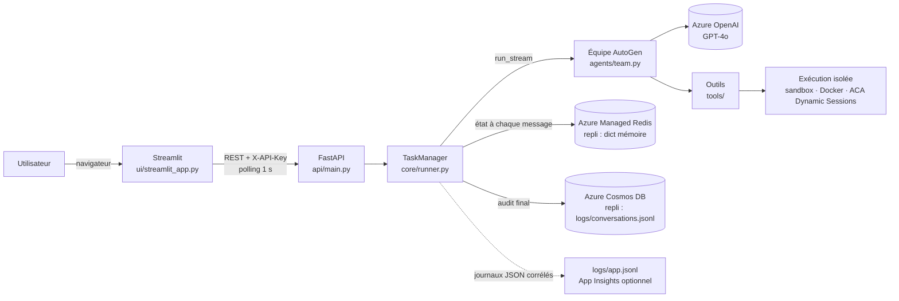
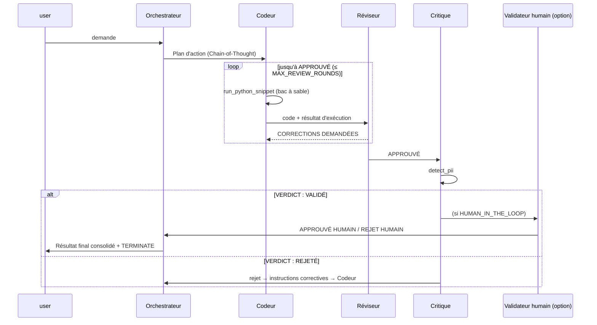

# Document d'architecture technique

## 1. Vue d'ensemble



## 2. Topologie hub-and-spoke (patron `selector`)



Le prochain locuteur est choisi par des **règles déterministes** (`make_selector`), ce qui rend le flux prévisible, testable et économe en tokens. Le LLM n'est consulté que si aucune règle ne s'applique.

| Dernier locuteur | Condition | Suivant |
|---|---|---|
| user | — | orchestrateur |
| orchestrateur | — | codeur |
| codeur | — | reviseur |
| reviseur | `CORRECTIONS DEMANDÉES` | codeur |
| reviseur | `APPROUVÉ` | critique |
| critique | `VERDICT : VALIDÉ` | validateur_humain (si activé) ou orchestrateur |
| critique | rejet | orchestrateur |
| validateur_humain | — | orchestrateur |

### Patrons alternatifs (exigence F1)

- **sequential** : `RoundRobinGroupChat` dans un ordre fixe (Orchestrateur, Codeur, Réviseur, Critique, puis retour à l'Orchestrateur). Le Critique rejette tant que des corrections du Réviseur sont en attente.
- **nested** : le Codeur et le Réviseur forment une équipe interne (`RoundRobinGroupChat`, arrêt sur `APPROUVÉ`), encapsulée dans un `SocietyOfMindAgent` nommé `atelier_dev`. L'équipe principale ne voit que le code approuvé.

## 3. Conditions d'arrêt (Bug 1, US 4.2)

Combinées par un OU logique (`build_termination`) :

1. `TextMentionTermination("TERMINATE", sources=["orchestrateur"])` : fin normale. Le mot n'est pris en compte que s'il vient de l'Orchestrateur, ce qui évite un arrêt prématuré quand un autre agent le cite.
2. `MaxMessageTermination(MAX_MESSAGES)` : plafond de tours.
3. `TokenUsageTermination(MAX_TOTAL_TOKENS)` : budget de coût.
4. `TimeoutTermination(TASK_TIMEOUT_SECONDS)`.
5. `ReviewLoopTermination(MAX_REVIEW_ROUNDS)` : arrêt anticipé quand les rejets dépassent N.
6. `RepetitionTermination` : détection de cycle, quand les n derniers messages (source + contenu) reproduisent les n précédents.

Après un arrêt anticipé, la tâche passe au statut `ARRETE`. Son résultat contient la raison de l'arrêt et la dernière version du code.

## 4. Gestion du contexte (Bug 2, F4)

Chaque agent, ainsi que le sélecteur, utilise un `TokenLimitedChatCompletionContext(token_limit=CONTEXT_TOKEN_LIMIT)`. Les messages les plus anciens sont retirés pour que la requête reste sous la limite. Une erreur `context_length_exceeded` qui passerait malgré tout est convertie en message explicite (statut `ERREUR`).

## 5. Exécution de code (Bug 3)

```
code généré ──► analyze_code_safety (AST) ──refus──► message d'erreur à l'agent
                         │ OK
                         ▼
          CODE_EXECUTOR = sandbox │ docker │ aca │ disabled
```

- **AST** : bloque les imports `os`, `sys`, `subprocess`, `socket`, `shutil`, etc., les appels `eval`, `exec`, `open`, `__import__`, etc., et l'accès aux attributs « dunder ».
- **sandbox** : `python -I`, répertoire temporaire, variables d'environnement vidées, `RLIMIT_CPU`/`AS`/`FSIZE`, timeout de 30 s, sortie tronquée à 4 000 caractères.
- **docker** : `DockerCommandLineCodeExecutor`, conteneur jetable (équivalent v0.4 de `use_docker=True`).
- **aca** : `ACADynamicSessionsCodeExecutor` et identité managée. C'est la seule option isolée compatible avec Azure Container Apps, qui ne permet pas Docker-in-Docker (rapport §10.6).

Chaque outil passe par `robust_tool` : timeout, retry exponentiel (3 tentatives sur les erreurs transitoires) et journalisation de l'entrée, de la sortie, de la durée et du statut. Ce journal est joint au document d'audit.

## 6. Données et sécurité

| Donnée | Stockage | Rétention |
|---|---|---|
| État de tâche (messages, statut) | Redis `mas:task:{id}` (repli : mémoire) | `REDIS_TTL_SECONDS` (24 h) |
| Index des tâches | Redis `mas:tasks:index` (200 dernières) | — |
| Audit complet (conversation, outils, métriques) | Cosmos `smartovate_mas/conversations`, clé `/session_id` | permanente |
| Journaux applicatifs | `logs/app.jsonl` (+ App Insights) | — |

- Les secrets ne se trouvent que dans `.env`, exclu de Git et de Docker, ou dans les secrets Container Apps (`secretRef`). Le script de test de connexion n'affiche jamais la clé.
- La clé d'API applicative est comparée en temps constant (`hmac.compare_digest`). La clé par défaut est refusée en `APP_ENV=production`.
- Les données personnelles sont détectées dans la demande (signalées dans l'UI), vérifiées par le Critique et masquées dans l'audit (`REDACT_PII_IN_AUDIT`).

## 7. Modules

| Paquet | Fichier | Responsabilité |
|---|---|---|
| config | `settings.py` | Paramètres pydantic-settings |
| | `model_client.py` | Fabrique Azure OpenAI (version explicite, `max_tokens`, `temperature`) |
| | `mock_client.py` | LLM simulé déterministe (développement et tests) |
| agents | `orchestrateur.py`, `specialiste.py`, `critique.py`, `humain.py` | Définition des agents |
| | `team.py` | Patrons de topologie, sélection du locuteur, conditions d'arrêt |
| | `termination.py` | Conditions d'arrêt personnalisées |
| | `prompts.py` | Prompts système |
| tools | `base_tools.py` | Calcul sûr, PII, revue de sécurité, exécution de code |
| | `code_execution.py` | AST et exécuteurs sandbox/docker/aca |
| memory | `redis_memory.py`, `cosmos_logger.py` | Persistance avec repli |
| core | `runner.py` | Cycle de vie des tâches, flux, HITL, métriques, audit |
| | `observability.py` | Journaux JSON corrélés |
| api | `main.py` | API REST |
| ui | `streamlit_app.py` | Interface |
| scripts | `test_connection.py`, `cli.py`, `benchmark_performances.py` | Outils |
| infra | `deploy_azure.sh` | Infrastructure Azure |
